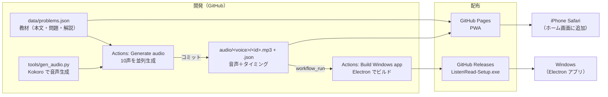
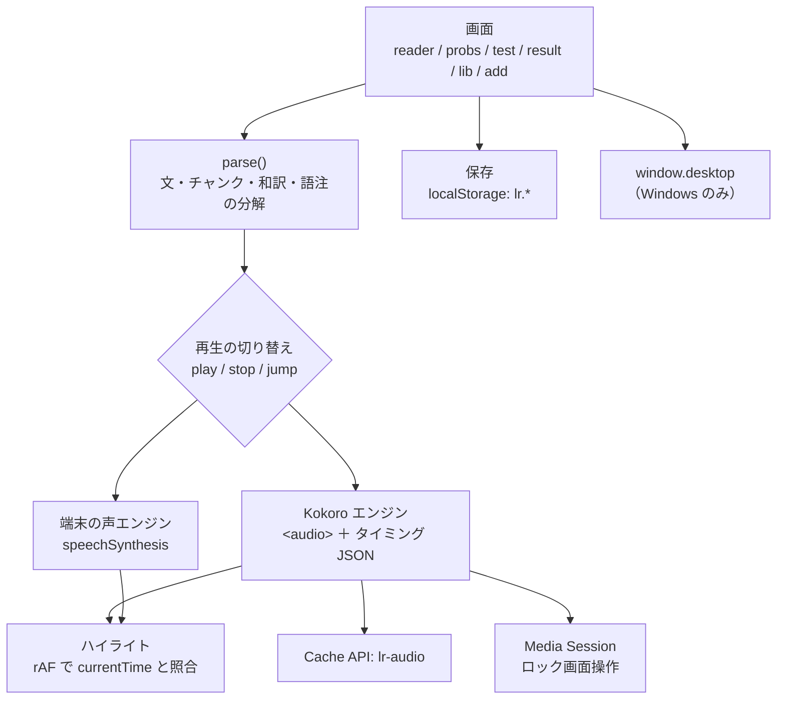

# アーキテクチャ概要（現状：2026-11 時点）

この文書は「いま動いている作り」を記録する。変える判断は ADR（`docs/adr/`）に残す。

## 1. 全体像（システムの境界）



**サーバーは持たない**。すべて静的ファイルで、生成処理は GitHub Actions が肩代わりする（ADR-0001, 0002）。

## 2. コンテナ（実行される単位）

| 単位 | 技術 | 主なファイル | 役割 |
|---|---|---|---|
| Web アプリ | 素の HTML/CSS/JS（ビルドなし） | `index.html`（約1100行） | 画面、再生エンジン、テスト、記録をすべて担う |
| Service Worker | SW | `sw.js` | アプリ本体をオフラインで使えるようにする（ネット優先、だめならキャッシュ） |
| 音声生成 | Python 3.11 / Kokoro 0.9.4 / ffmpeg | `tools/gen_audio.py`, `tools/manifest.py` | 文の分割 → 読み方の変換 → 合成 → チャンクの時刻計算 → mp3 と json を出力 |
| Windows ラッパー | Electron 44 / electron-builder | `desktop/main.js`, `preload.js` | `app://` で同梱の Web を配信し、タスクバー連携・ズーム・ウィンドウ状態の保存を行う |
| CI/CD | GitHub Actions | `.github/workflows/*.yml` | 音声生成とコミット、Windows 版のビルドとリリース |

## 3. Web アプリの内部構成（論理）

`index.html` の中に、次の役割が同居している（ADR-0006 で分割を検討）。



### 保存しているデータ（端末内のみ）
| キー | 中身 |
|---|---|
| `lr.settings` | 声、速さ、表示設定 |
| `lr.texts` | 利用者が追加した長文 |
| `lr.current` | 最後に開いていた文書 |
| `lr.pstats` | 問題ごとの記録（再生回数、WPM、最高点など） |
| `lr.calib` | 端末の声の実測速度（WPM の補正用） |
| Cache `lr-audio` | ダウンロードした mp3 と json |

## 4. データの約束事（コンポーネント間の契約）

### 4.1 教材 `data/problems.json`
```jsonc
[{ "id": "p01", "type": "E-mail",
   "raw": "TITLE: ...\nThe coffee machine / on the third floor / ...\n= 和訳\n...",
   "qs": [{ "q": "英語の設問", "qj": "設問の和訳",
            "c": [["選択肢(英)", "和訳", "この選択肢の解説"], …4つ],
            "a": 1,             // 正解の添字（0始まり）
            "pt": "この問題のポイント" }] }]
```

`raw` の書き方：
- `/` でチャンクに区切る
- `=` で始まる行は直前の行の和訳
- `TITLE:` はタイトル
- `WORDS:` 以降は語注

### 4.2 音声タイミング `audio/<voice>/<id>.json`
```jsonc
{ "v": 1, "hash": "…", "voice": "bf_emma", "id": "p01",
  "dur": 123.4,       // 全体の秒数
  "speech": 110.2,    // 見出しを除く発話秒数（WPM 計算用）
  "words": 310,
  "sents": [{ "t": "文", "s": 0.0, "e": 3.2, "c": [[0.0, 1.1], [1.1, 3.2]] }] }
```

### 4.3 重要な不変条件
- **文の分割が Python（`gen_audio.py` の `parse`）と JS（`index.html` の `parse`）で完全に一致すること**
  - ずれると、ハイライトが別の文に付く
  - 現状は手作業で確認している（530文が一致）。→ 自動テスト化が必要
- 画面の文字と読み上げる文字は別物。`spoken()` で「9:00」を「nine」のように変換し、チャンクの数と順序は保つ（ADR-0005）
- `hash` は**実際に読み上げる文字列**から作る。変わった教材だけが再生成される

## 5. 品質特性（大事にすること）

| 特性 | 目標 | 現状 |
|---|---|---|
| 同期の正確さ | ハイライトのずれが体感で 0.1 秒以内 | ◎ 事前生成のタイミングを使っている |
| オフライン | 一度開いた教材は機内モードでも再生できる | ○ 音声は手動のダウンロードが必要 |
| 起動の速さ | iPhone で 2 秒以内に操作できる | ○ |
| 保守のしやすさ | 1 機能の変更が 1〜2 ファイルで済む | △ index.html 1 ファイルに集中 |
| 検証のしやすさ | 主要ロジックが自動テストされる | ✕ テストなし |
| 配布サイズ | Windows インストーラー 300MB 以下 | △ 約 300MB（音声 10 声を同梱） |

## 6. 既知の技術的負債・リスク

| # | 内容 | 影響 | 対応 |
|---|---|---|---|
| T1 | `index.html` に全ロジックが集中 | 変更の衝突、読みにくさ | ADR-0006（ES Modules に分割） |
| T2 | 文の分割処理が Python と JS で二重にある | ハイライトがずれる | 共通テストデータで一致を CI で検証 |
| T3 | 自動テストがない | 修正のたびに手動で確認 | 単体テストと CI を導入 |
| T4 | Windows 版で「端末の声」が出ない | 利用者が自分で入れた長文を再生できない | Issue 化（SAPI 経由の合成を検討） |
| T5 | 音声 10 声 × 33 問を Git に保存（188MB） | リポジトリの肥大化 | 当面は許容。増えたら Releases か LFS へ |
| T6 | Windows 版は署名なし | SmartScreen の警告 | README で案内（費用ゼロの方針） |
| T7 | `sw.js` のキャッシュ名が固定 | 古いファイルが残ることがある | バージョンを付けて自動更新 |
